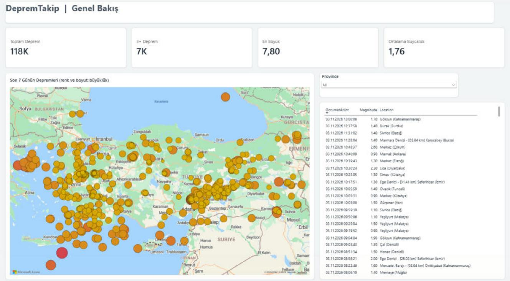
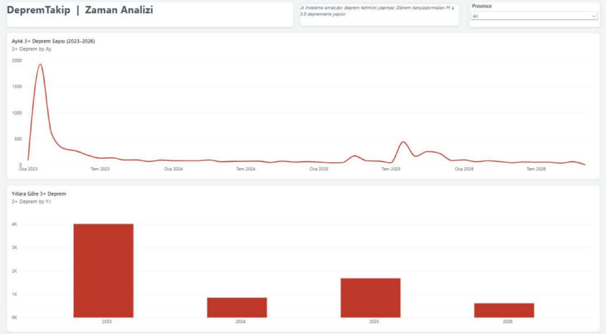
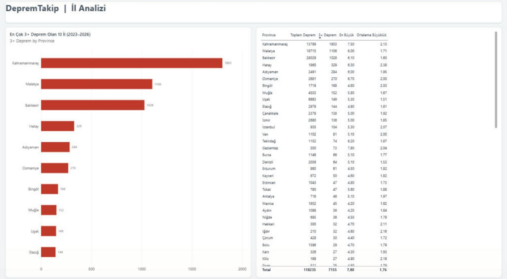

# DepremTakip

Türkiye'deki depremleri **AFAD**'dan otomatik olarak toplayan, geçmişe dönük sorgulanabilir şekilde saklayan bir **ASP.NET Core Web API** ve bu veriyi analiz eden bir **Power BI dashboard**'u.

Proje; iş analizi (gereksinimler, iş kuralları, kullanıcı hikâyeleri), backend geliştirme ve veri görselleştirme adımlarının hepsini kapsar.



## Neden?

Deprem bilgisine birçok kaynaktan ulaşılabiliyor, ancak bu kaynaklar çoğunlukla **son depremlerin anlık listesini** veriyor. "Bu ilde son bir ayda kaç deprem oldu?", "2023'ten bu yana deprem sayısı nasıl değişti?" gibi sorulara kolayca cevap bulunamıyor. DepremTakip bu veriyi düzenli toplayıp saklar ve analiz edilebilir hale getirir.

## Özellikler

- **Otomatik güncelleme:** Arka plan servisi AFAD'ı **1 dakikada bir** kontrol eder; yeni depremleri kaydeder, AFAD'ın sonradan düzelttiği büyüklükleri günceller.
- **Kopya kayıt yok:** Her deprem AFAD'ın `EventId`'si ile tanımlanır; hem uygulamada hem veritabanında (unique index) kontrol edilir.
- **Geçmiş veri:** 2023 başından bugüne **120 binden fazla** deprem kaydı (AFAD + EMSC).
- **Filtreli listeleme:** İl, hazır dönem / tarih aralığı, büyüklük ve derinliğe göre filtreleme, sıralama ve sayfalama.
- **İl özeti:** Bir il için seçilen dönemdeki deprem sayısı, en büyük deprem, ortalama büyüklük ve büyüklük grupları.
- **Swagger dokümantasyonu:** Türkçe açıklamalar; il, dönem ve sıralama için açılır listeler.
- **Power BI dashboard:** 3 sayfa (Genel Bakış, Zaman Analizi, İl Analizi), veritabanına DirectQuery ile bağlı.

## Teknolojiler

.NET 8 · ASP.NET Core Web API · Entity Framework Core · SQL Server · BackgroundService · Swagger (Swashbuckle) · Power BI (DirectQuery, DAX)

## Mimari

```
AFAD apiv2 ──┐                                   ┌──> REST API (Swagger)
             ├─> EarthquakeSyncService ─> SQL Server
EMSC FDSN ───┘   (1 dk'da bir, upsert)           └──> Power BI (DirectQuery)
```

| Klasör | İçerik |
|---|---|
| `Afad/`, `Emsc/` | Veri kaynaklarının HTTP istemcileri (typed HttpClient) |
| `Services/` | Senkronizasyon (BackgroundService) ve kayıt / güncelleme (upsert) |
| `Controllers/` | `GET /api/earthquakes`, `GET /api/summary/province` |
| `Dtos/`, `Helpers/` | Cevap modelleri, 81 il listesi ve il eşleştirme |
| `powerbi/` | Power BI dosyası (`DepremTakip.pbix`) |
| `docs/` | İş analizi dokümanı ve Power BI teması |

## API

| Uç nokta | Açıklama |
|---|---|
| `GET /api/earthquakes` | Filtreli, sıralı, sayfalı deprem listesi (`Province`, `Period` veya `From`/`To`, `MinMagnitude`, `MaxMagnitude`, `MaxDepthKm`, `SortBy`, `Page`, `PageSize`) |
| `GET /api/summary/province` | Bir il için dönem özeti (`Province`, `Period`) |

Tüm uç noktalar giriş gerektirmez. Hatalı isteklerde ne yapılması gerektiğini söyleyen bir mesaj döner.

## Dashboard

| Zaman Analizi | İl Analizi |
|---|---|
|  |  |

**Öne çıkan bulgular** (ayrıntılar iş analizi dokümanında):

- **Şubat 2023:** Kahramanmaraş depremleri sonrası tek ayda 3.875 deprem; dönemin en yüksek değeri.
- **2025 yükselişi:** Kaynağı Ağustos ve Ekim 2025 Sındırgı (Balıkesir) depremleri ve ardından gelen deprem fırtınası.
- **Uşak'ın ilk 10'da olması:** Simav bölgesindeki depremlerin en yakın il merkezi kuralıyla Uşak'a atanmasından kaynaklanıyor olabilir. Bu, aşağıdaki veri sınırlamasını doğrulayan bir örnek.

## Veri kaynakları ve kalite notları

- **Canlı veri AFAD'dan, geçmiş veri EMSC'den** alınır. AFAD'ın servisi yalnızca son ~2 haftanın verisini verdiği için 2023'ten bu yana olan geçmiş veri [EMSC](https://www.seismicportal.eu/) (Avrupa-Akdeniz Sismoloji Merkezi) FDSN servisinden doldurulmuştur. Her kaydın kaynağı `Source` alanında (AFAD / EMSC) saklanır.
- **Tamlık eşiği (M ≥ 3.0):** EMSC küçük depremleri AFAD kadar eksiksiz kaydetmez. Bu yüzden dönemler arası karşılaştırmalar yalnızca **büyüklüğü 3.0 ve üzeri** depremlerle yapılır (dashboard'daki "3+ Deprem" ölçüsü). Toplam deprem sayısı dönemler arasında karşılaştırılmamalıdır.
- **Yaklaşık il:** EMSC il bilgisi vermez; il, depremin **en yakın il merkezine** göre atanır. İl sınırına yakın depremler komşu ile yazılabilir (ör. 2023 Pazarcık depremi Gaziantep'e atanmıştır).
- **Sorumluluk sınırı:** Bu proje bir **erken uyarı veya tahmin sistemi değildir**; deprem sonrası bilgi ve inceleme amaçlıdır.

## İş analizi

Projenin gereksinimleri kod yazılmadan önce ve geliştirme boyunca dokümante edildi: problem tanımı, paydaşlar, fonksiyonel ve fonksiyonel olmayan gereksinimler, iş kuralları, kullanıcı hikâyeleri ve kabul kriterleri, kapsam değişikliği kararları, test sırasında bulunan kullanılabilirlik sorunları, KPI tanımları, izlenebilirlik tablosu ve bulgular.

📄 **[docs/is-analizi.md](docs/is-analizi.md)**

## Çalıştırma

Gereksinimler: .NET 8 SDK, SQL Server (Express yeterli), Power BI Desktop (dashboard için).

1. `DepremTakip.Api/appsettings.json` içindeki `ConnectionStrings:Default` değerini kendi SQL Server'ınıza göre düzenleyin.
2. Veritabanını oluşturun:
   ```bash
   cd DepremTakip.Api
   dotnet ef database update
   ```
3. Uygulamayı çalıştırın (`dotnet run` veya Visual Studio'da F5). Swagger arayüzü açılır; arka plan servisi verileri doldurmaya başlar. İlk çalıştırmada geçmiş verinin dolması biraz zaman alır.
4. `powerbi/DepremTakip.pbix` dosyasını açın; gerekirse veri kaynağı ayarlarından sunucu adını güncelleyin.

Ayarlar (`appsettings.json` → `Sync`):

| Ayar | Varsayılan | Açıklama |
|---|---|---|
| `IntervalMinutes` | 1 | AFAD kontrol aralığı (dakika) |
| `HistoryDays` | 1400 | Geriye dönük doldurulacak gün sayısı (~2023 başı) |
| `AfadWindowDays` | 7 | AFAD'dan alınan son gün aralığı |

## Yol haritası

- [ ] İl atamasını il merkezine uzaklık yerine gerçek il sınırlarıyla yapmak
- [ ] Kullanıcı kaydı ve alarm kuralları ("Ankara'da 4.0 ve üzeri olursa haber ver")
- [ ] Birim testleri

---

Hazırlayan: **Emine Gül Palabıyık** · [LinkedIn](https://www.linkedin.com/in/eminegulpalabiyik) · [GitHub](https://github.com/eminegplbyk)
