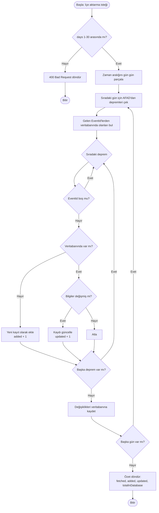
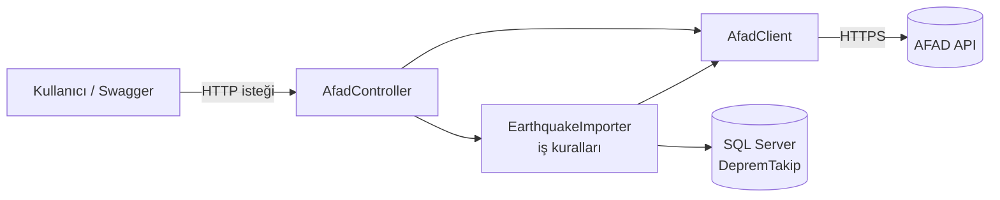

# DepremTakip — İş Analizi Dokümanı

| | |
|---|---|
| **Proje** | DepremTakip API |
| **Hazırlayan** | Emine Gül Palabıyık |
| **Sürüm** | 0.1 — Faz 1 (Veri toplama) |
| **Tarih** | 29.10.2026 |
| **Durum** | Faz 1 tamamlandı, Faz 2 planlanıyor |

---

## 1. Problem Tanımı

Türkiye'de deprem verileri AFAD tarafından anlık olarak yayımlanır. Ancak bu veriler:

- **Geçmişe dönük analiz için uygun bir yerde tutulmaz.** AFAD'ın sitesinde anlık listeye bakılabilir, fakat "son 30 günde Malatya'da kaç deprem oldu?" gibi soruları cevaplamak için veriyi tek tek toplamak gerekir.
- **Kişiye özel değildir.** Bir kullanıcı sadece kendi ilini veya belirli bir büyüklüğün üzerindeki depremleri takip etmek isterse bunu yapabileceği basit bir servis yoktur.
- **Başka uygulamalara hazır sunulmaz.** Bir mobil uygulama ya da rapor aracı geliştirmek isteyen biri AFAD'ın ham verisini kendisi işlemek zorundadır.

## 2. Amaç

AFAD deprem verilerini **düzenli olarak toplayan, kendi veritabanında saklayan** ve bu veriyi **filtrelenebilir, analiz edilebilir ve kişiselleştirilebilir** şekilde sunan bir REST API geliştirmek.

## 3. Kapsam

### 3.1 Faz planı

| Faz | İçerik | Durum |
|---|---|---|
| **Faz 1** | AFAD'dan veri çekme, veritabanına kaydetme, kopya kayıt önleme | ✅ Tamamlandı |
| Faz 2 | Otomatik (zamanlanmış) senkronizasyon | ⏳ Planlandı |
| Faz 3 | Filtreli listeleme ve sayfalama | ⏳ Planlandı |
| Faz 4 | İstatistik uç noktaları | ⏳ Planlandı |
| Faz 5 | Kullanıcı kaydı / giriş (JWT) | ⏳ Planlandı |
| Faz 6 | Kullanıcıya özel alarm kuralları | ⏳ Planlandı |
| Faz 7 | Power BI raporu | ⏳ Planlandı |

### 3.2 Kapsam dışı

- Deprem verisinin kendisinin üretilmesi veya doğrulanması (tek kaynak AFAD'dır).
- Mobil uygulama veya web arayüzü (bu proje yalnızca API'dir).
- SMS / e-posta / push bildirimi gönderimi (alarmlar API üzerinden sorgulanabilir kayıt olarak tutulacak).

## 4. Paydaşlar

| Paydaş | Beklentisi |
|---|---|
| **Son kullanıcı** | Kendi bölgesindeki depremleri kolayca takip etmek, belirli büyüklükte deprem olunca haberdar olmak |
| **Uygulama geliştirici** (API'yi kullanacak kişi) | Temiz, belgelenmiş, filtrelenebilir bir deprem verisi kaynağı |
| **Veri analisti** | Geçmişe dönük, tutarlı ve kopyasız veri üzerinden rapor hazırlamak |
| **AFAD** (veri sağlayıcı) | Servisine aşırı yük bindirilmemesi |

## 5. Fonksiyonel Gereksinimler

| No | Gereksinim | Faz | Durum |
|---|---|---|---|
| FR-01 | Sistem, AFAD'dan belirli bir zaman aralığındaki depremleri çekebilmelidir. | 1 | ✅ |
| FR-02 | Kullanıcı, AFAD'daki son depremleri **kaydetmeden** önizleyebilmelidir. | 1 | ✅ |
| FR-03 | Sistem, AFAD'dan çekilen depremleri veritabanına kaydedebilmelidir. | 1 | ✅ |
| FR-04 | Aynı deprem veritabanına birden fazla kez kaydedilmemelidir. | 1 | ✅ |
| FR-05 | AFAD bir depremin bilgisini sonradan değiştirirse (ör. büyüklük revizyonu) kayıt güncellenmelidir. | 1 | ✅ |
| FR-06 | İçe aktarma işlemi sonunda kaç kayıt çekildiği, eklendiği ve güncellendiği raporlanmalıdır. | 1 | ✅ |
| FR-07 | Sistem, kullanıcı müdahalesi olmadan belirli aralıklarla AFAD'ı kontrol etmelidir. | 2 | ⏳ |
| FR-08 | Depremler tarih, büyüklük ve ile göre filtrelenip sayfalı listelenebilmelidir. | 3 | ⏳ |
| FR-09 | İl bazında sayı, en büyük depremler ve günlük dağılım istatistikleri sunulmalıdır. | 4 | ⏳ |
| FR-10 | Kullanıcı kayıt olup giriş yapabilmelidir. | 5 | ⏳ |
| FR-11 | Giriş yapan kullanıcı il ve minimum büyüklük içeren alarm kuralı tanımlayabilmelidir. | 6 | ⏳ |

## 6. Fonksiyonel Olmayan Gereksinimler

| No | Gereksinim | Nasıl karşılanıyor |
|---|---|---|
| NFR-01 | **Veri bütünlüğü:** Kopya kayıt oluşmamalı. | Kod seviyesinde kontrol + veritabanında `EventId` üzerinde unique index (çift kontrol) |
| NFR-02 | **Performans:** Filtre sorguları hızlı çalışmalı. | Tarih, büyüklük ve il kolonlarında index |
| NFR-03 | **Kaynağa saygı:** AFAD'a aşırı yük bindirilmemeli. | Çok günlük içe aktarmalar gün gün parçalanıyor; tek istekte en fazla 30 gün |
| NFR-04 | **Zaman tutarlılığı:** Saatler karışmamalı. | Tüm zamanlar UTC saklanıyor, gösterimde yerel saate çevrilecek |
| NFR-05 | **Dayanıklılık:** AFAD yanıt vermezse sistem kilitlenmemeli. | AFAD isteklerinde 30 saniye zaman aşımı |
| NFR-06 | **Değişime dayanıklılık:** AFAD veri formatı değişirse etkisi sınırlı olmalı. | AFAD verisi için ayrı DTO sınıfı; veritabanı modeli bundan bağımsız |
| NFR-07 | **Belgelenmiş API:** Kullanıcılar uç noktaları kolayca keşfedebilmeli. | Swagger / OpenAPI arayüzü |

## 7. Kullanıcı Hikâyeleri ve Kabul Kriterleri (Faz 1)

### US-01 — AFAD verisini önizleme

> **Bir** geliştirici **olarak**, AFAD'dan son birkaç saatin depremlerini veritabanına kaydetmeden görmek **istiyorum**, **böylece** AFAD bağlantısının çalıştığını ve verinin nasıl geldiğini kontrol edebilirim.

**Kabul kriterleri:**
- [x] `GET /api/afad/preview?hours=3` çağrıldığında son 3 saatin depremleri JSON olarak döner.
- [x] `hours` 1–48 aralığı dışındaysa `400 Bad Request` döner.
- [x] Bu işlem veritabanında hiçbir değişiklik yapmaz.
- [x] AFAD'ın metin olarak gönderdiği sayılar (`"3.3"`) sayıya çevrilmiş olarak gelir.

### US-02 — Depremleri veritabanına aktarma

> **Bir** sistem yöneticisi **olarak**, son X günün depremlerini tek işlemle veritabanına aktarmak **istiyorum**, **böylece** analiz ve sorgulama için geçmiş veriye sahip olurum.

**Kabul kriterleri:**
- [x] `POST /api/afad/import?days=7` çağrıldığında son 7 günün depremleri veritabanına kaydedilir.
- [x] `days` 1–30 aralığı dışındaysa `400 Bad Request` döner.
- [x] Yanıtta `fetched`, `added`, `updated` ve `totalInDatabase` değerleri bulunur.

### US-03 — Kopya kayıt önleme

> **Bir** veri analisti **olarak**, aynı depremin veritabanında yalnızca bir kez bulunmasını **istiyorum**, **böylece** sayımlarım ve istatistiklerim doğru olur.

**Kabul kriterleri:**
- [x] Aynı aralık için içe aktarma ikinci kez çalıştırıldığında `added = 0` olur.
- [x] Kod hatası olsa bile veritabanı aynı `EventId` ile ikinci kaydı reddeder.
- [x] AFAD bir depremin büyüklüğünü, derinliğini veya konumunu değiştirmişse mevcut kayıt güncellenir ve `updated` sayısına eklenir.

## 8. İş Kuralları

| No | Kural |
|---|---|
| BR-01 | Bir deprem, AFAD'ın verdiği **EventId** ile tanımlanır. Aynı EventId'ye sahip iki kayıt olamaz. |
| BR-02 | Veritabanının kendi `Id` numarası yalnızca iç kullanım içindir; depremi tanımak için kullanılmaz. |
| BR-03 | EventId'si boş gelen kayıtlar geçersiz sayılır ve atlanır. |
| BR-04 | Mevcut bir kaydın büyüklük, derinlik veya konum bilgisi AFAD'dakinden farklıysa AFAD'daki bilgi esas alınır ve kayıt güncellenir. |
| BR-05 | Tüm deprem zamanları UTC olarak saklanır (AFAD verisi UTC gelir; Türkiye saati = UTC+3). |
| BR-06 | İl ve ilçe bilgisi boş olabilir (ör. denizde gerçekleşen depremler). |
| BR-07 | Önizleme en fazla 48 saat, içe aktarma en fazla 30 gün geriye gidebilir. |

## 9. Süreç Akışı — Veri İçe Aktarma

## 10. Sistem Bileşenleri

| Bileşen | Sorumluluğu |
|---|---|
| **AfadController** | Dışarıdan gelen istekleri karşılar, parametreleri doğrular, sonucu döndürür. |
| **AfadClient** | AFAD'a HTTP isteği atar, gelen JSON'u `AfadEventDto` listesine çevirir. |
| **EarthquakeImporter** | İş kurallarını uygular: yeni mi, var mı, değişmiş mi; ekle/güncelle/atla. |
| **AppDbContext** | Uygulama ile SQL Server arasındaki köprü (Entity Framework Core). |

## 11. Veri Modeli

### 11.1 Earthquakes tablosu

| Alan | Tip | Zorunlu | Açıklama |
|---|---|---|---|
| Id | int (PK, otomatik artan) | ✔ | Veritabanının iç numarası |
| EventId | nvarchar(32), **unique** | ✔ | AFAD'ın deprem numarası |
| OccurredAtUtc | datetime2 | ✔ | Depremin gerçekleştiği zaman (UTC) |
| Magnitude | float | ✔ | Büyüklük |
| MagnitudeType | nvarchar(8) | ✔ | Büyüklük türü (ML, Mw…) |
| DepthKm | float | ✔ | Derinlik (km) |
| Latitude | float | ✔ | Enlem |
| Longitude | float | ✔ | Boylam |
| Location | nvarchar(256) | ✔ | AFAD'ın konum metni |
| Province | nvarchar(64) | | İl (boş olabilir) |
| District | nvarchar(64) | | İlçe (boş olabilir) |
| CreatedAtUtc | datetime2 | ✔ | Kaydın sisteme eklendiği zaman |

**Index'ler:** `EventId` (unique), `OccurredAtUtc`, `Magnitude`, `Province`

### 11.2 AFAD alanlarının eşleştirilmesi

| AFAD JSON alanı | Örnek değer | Sistemdeki alan | Not |
|---|---|---|---|
| eventID | `"597700"` | EventId | |
| date | `"2026-10-29T16:50:22"` | OccurredAtUtc | UTC olarak işaretleniyor |
| magnitude | `"3.3"` | Magnitude | Metin → sayı |
| type | `"ML"` | MagnitudeType | |
| depth | `"20.18"` | DepthKm | Metin → sayı |
| latitude / longitude | `"35.92983"` | Latitude / Longitude | Metin → sayı |
| location | `"Akdeniz - [79.38 km] Kumluca (Antalya)"` | Location | |
| province / district | `"Antalya"` / `"Kumluca"` | Province / District | Boş gelebilir |
| rms, country, neighborhood, isEventUpdate, lastUpdateDate | — | *kullanılmıyor* | |

## 12. API Uç Noktaları (Faz 1)

| Metot | Adres | Parametre | Ne yapar | Veritabanını değiştirir mi? |
|---|---|---|---|---|
| GET | `/api/afad/preview` | `hours` (1–48, varsayılan 3) | AFAD'daki son depremleri gösterir | Hayır |
| POST | `/api/afad/import` | `days` (1–30, varsayılan 1) | Son X günün depremlerini kaydeder | Evet |

## 13. Varsayımlar, Kısıtlar ve Riskler

| Tür | Açıklama | Önlem |
|---|---|---|
| Varsayım | AFAD'ın `apiv2/event/filter` servisi erişilebilir ve ücretsizdir. | — |
| Kısıt | AFAD bu servis için resmi bir doküman yayımlamamıştır; alan adları gözlemle belirlenmiştir. | AFAD verisi ayrı bir DTO'da tutuldu; format değişirse yalnızca o kısım güncellenir. |
| Kısıt | AFAD sayısal alanları metin olarak gönderir. | JSON okuyucusu metin sayıları kabul edecek şekilde ayarlandı. |
| Risk | AFAD servisi geçici olarak yanıt vermeyebilir. | 30 sn zaman aşımı; Faz 2'de hata olursa bir sonraki turda tekrar deneme. |
| Risk | Aynı anda iki içe aktarma çalışırsa kopya oluşma ihtimali. | Veritabanı seviyesinde unique index. |

## 14. Test Sonuçları (29.10.2026)

| Test | Beklenen | Gerçekleşen | Sonuç |
|---|---|---|---|
| Önizleme (son 3 saat) | AFAD'daki son depremler JSON olarak gelir, sayılar tırnaksızdır | 12 deprem listelendi, sayılar doğru tipte | ✅ |
| İlk içe aktarma (7 gün) | Tüm depremler eklenir | 571 deprem eklendi | ✅ |
| İkinci içe aktarma (aynı 7 gün) | `added = 0` | fetched: 571, added: 0, updated: 0, total: 571 | ✅ |
| Veritabanı kontrolü (SSMS) | Kayıtlar tabloda görünür | Kayıtlar görüldü | ✅ |

## 15. Sözlük

| Terim | Açıklama |
|---|---|
| **API** | Uygulamaların birbirleriyle konuşmasını sağlayan arayüz. Bu projede dışarıdan gelen isteklere deprem verisi sunan servis. |
| **REST** | API tasarım tarzı. Her işlem bir adres (`/api/afad/import`) ve bir HTTP metodu (GET, POST…) ile ifade edilir. |
| **GET / POST** | GET yalnızca veri okur, hiçbir şeyi değiştirmez. POST bir işlem yapar veya veri ekler. |
| **JSON** | API'lerin veri alışverişinde kullandığı metin formatı. |
| **DTO** | Sadece veri taşımak için kullanılan sınıf. Burada AFAD'dan gelen veriyi karşılayan `AfadEventDto`. |
| **Entity** | Veritabanındaki bir tabloya karşılık gelen sınıf. Burada `Earthquake`. |
| **EF Core** | C# kodunu SQL'e çeviren kütüphane; SQL yazmadan veritabanıyla çalışmayı sağlar. |
| **Migration** | Veritabanı yapısındaki değişikliklerin kayıt altına alınmış hali. Tabloları kod üzerinden oluşturur. |
| **Unique index** | Bir kolonda aynı değerin iki kez bulunmasını veritabanı seviyesinde engelleyen kural. |
| **Upsert** | "Yoksa ekle, varsa güncelle" işlemi. |
| **UTC** | Dünya standart saati. Türkiye saati UTC+3'tür. |
| **Dependency Injection** | Bir sınıfın ihtiyaç duyduğu nesneleri kendisinin oluşturmak yerine .NET'ten hazır alması. |
| **Swagger** | API uç noktalarını tarayıcıdan görüp denemeyi sağlayan arayüz. |
